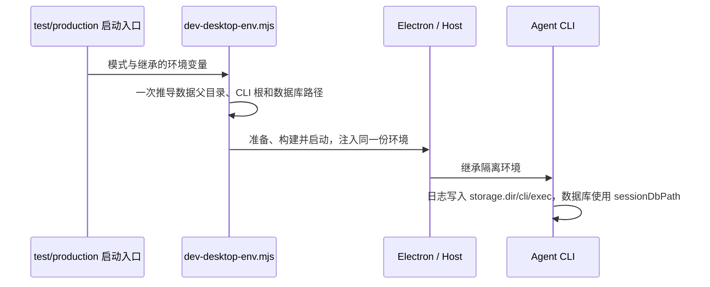

# Desktop 开发启动的数据隔离

## 产品规则与边界

`pnpm dev:desktop:test` 和 `dev-desktop-test.bat` 默认使用 `~/.zcode-dev-home` 作为开发数据父目录。Desktop 数据与设置、CLI 命令输出与会话数据库均须落在该目录内，避免误写已安装实例的 `~/.zcode`。本规则覆盖启动器负责注入的路径；用户显式覆盖某一路径时，以覆盖值为准。

普通 `pnpm dev:desktop:prod` 不注入隔离路径。production 模式显式指定 `ZCODE_DATA_BASE_DIR` 时，采用相同的联动规则。不修改系统 `HOME` / `USERPROFILE`，不迁移或删除既有数据，不改变独立 CLI 的默认路径。

## 唯一所有者与接口

`scripts/dev-desktop-env.mjs` 是开发子进程隔离环境的唯一推导者，Windows 批处理入口只提供开发目录并调用该脚本。脚本在启动构建、准备资源和 Electron 前解析一次环境，并把同一份配置传给所有子进程。

| 环境变量                 | 隔离启动默认值                         | 显式覆盖规则                                                   |
| ------------------------ | -------------------------------------- | -------------------------------------------------------------- |
| `ZCODE_DATA_BASE_DIR`    | test 模式为 `~/.zcode-dev-home`        | 非空值优先                                                     |
| `ZCODE_DESKTOP_HOME_DIR` | 数据父目录                             | 非空值优先                                                     |
| `ZCODE_STORAGE_DIR`      | 数据父目录下的 `.zcode`                | 非空值优先                                                     |
| `ZCODE_SESSION_DB_PATH`  | 最终 CLI 存储根下的 `cli/db/db.sqlite` | 非空 `ZCODE_SESSION_DB_PATH` 优先，其次兼容 `ZCODE_SESSION_DB` |

路径值去除首尾空白，空白值视为未设置。CLI 的 `storage.dir` 与 `storage.sessionDbPath` 是两个独立配置；两者都须注入，不能假定数据库随存储根自动移动。环境优先级沿用 CLI 现有配置解析，不更改协议或运行时所有权。

## 验收场景

1. 无显式路径的 test 启动，所有启动阶段均收到四个联动变量；CLI 根为 `~/.zcode-dev-home/.zcode`，数据库为其下 `cli/db/db.sqlite`。
2. 自定义数据父目录（含空格）时，Desktop 与 CLI 均基于该目录推导。
3. 显式 Desktop home、CLI 存储根和数据库覆盖值保持生效；仅覆盖 CLI 根时，默认数据库随最终 CLI 根移动。
4. 旧变量 `ZCODE_SESSION_DB` 的显式值仍生效；同时设置新旧数据库变量时，新变量优先。
5. 空白变量不阻止默认路径推导；Windows、macOS、Linux 使用平台路径拼接。
6. production 未指定数据父目录时不新增隔离变量；显式指定数据父目录则联动全部路径。
7. 回归测试执行真实启动脚本，在子进程 spawn 边界拦截环境；不实际构建或启动第二个 Electron 实例。
